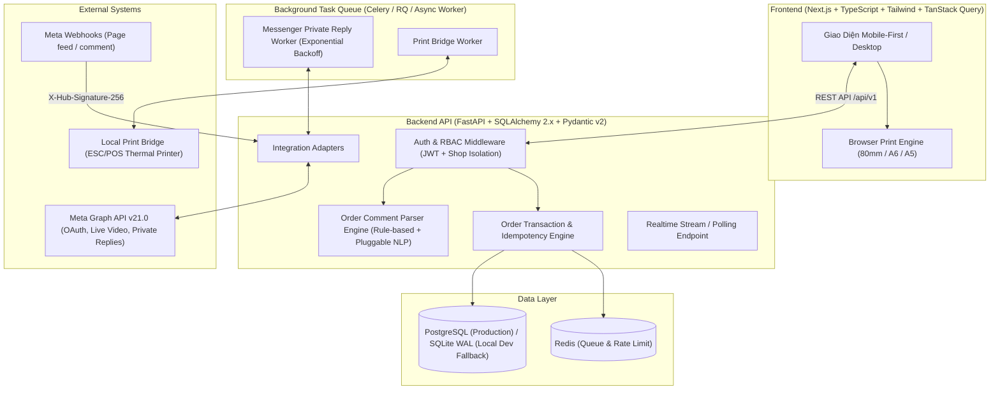

# KIẾN TRÚC HỆ THỐNG CHOTLIVE (FACEBOOK LIVE ORDER MANAGEMENT SYSTEM)

## 1. Tổng Quan Kiến Trúc

ChotLive là hệ thống quản lý chốt đơn livestream Facebook tại Việt Nam, hỗ trợ đồng thời **Facebook Fanpage** (tích hợp qua Meta Graph API & Webhooks chính thức) và **Facebook Trang Cá Nhân** (chế độ nhập thủ công / chuẩn hóa dữ liệu hợp pháp, tuân thủ tuyệt đối chính sách của Meta).

### Sơ Đồ Kiến Trúc Tổng Thể

---

## 2. Phân Tầng Module (Modular Monolith)

### 2.1. Backend (`backend/`)
- `app/core/`: Cấu hình (`config.py`), bảo mật JWT & mã hóa Fernet cho Meta Access Token (`security.py`), kết nối Database (`database.py`), Rate Limiting & Error Handling thống nhất.
- `app/models/`: Toàn bộ 16 bảng dữ liệu chuẩn hóa với SQLAlchemy 2.0 Declarative, hỗ trợ khóa ngoại, composite unique constraints và index.
- `app/schemas/`: Pydantic v2 schemas kiểm tra chặt chẽ dữ liệu đầu vào/đầu ra.
- `app/services/`:
  - `comment_parser.py`: Bộ phân tích cú pháp bình luận tiếng Việt (nhận diện mã sản phẩm, số lượng bằng số và chữ tiếng Việt, màu sắc, kích thước, ý định mua, độ tin cậy, cảnh báo mơ hồ).
  - `order_service.py`: Xử lý quy trình bấm **ĐÃ CHỐT** trong transaction cô lập, kiểm tra idempotency key, chống tạo đơn trùng khi nhiều nhân viên bấm cùng lúc, gán số thứ tự khách hàng (STT) tách biệt với mã đơn, snapshot giá sản phẩm.
  - `meta_adapter.py`: Adapter kết nối Meta Graph API chính thức và Mock Adapter minh bạch cho môi trường phát triển.
  - `messenger_service.py`: Quản lý gửi Private Reply qua endpoint `/{PAGE-ID}/messages` với `recipient.comment_id`, kiểm tra điều kiện 7 ngày, giới hạn 1 tin nhắn/comment, retry exponential backoff có giới hạn và trạng thái `NEEDS_MANUAL_ACTION`.
  - `print_service.py`: Tạo bản chụp (snapshot) phiếu in độc lập với lỗi máy in, hỗ trợ Browser Print HTML/CSS chuẩn tiếng Việt (80mm, A6, A5) và Local Print Bridge.
- `app/api/v1/`: Các router phân tách theo domain (`/auth`, `/shops`, `/members`, `/meta`, `/connected-accounts`, `/live-sessions`, `/webhooks`, `/comments`, `/products`, `/customers`, `/orders`, `/messaging`, `/print-jobs`, `/dashboard`, `/audit-logs`, `/health`).

### 2.2. Frontend (`frontend/`)
- Thiết kế **Mobile-First**, tiếng Việt 100%, tối ưu thao tác một chạm bằng ngón cái khi đang livestream.
- Tích hợp đầy đủ 17 màn hình/khu vực chức năng thông qua hệ thống điều hướng trực quan, không bị bàn phím di động che khuất nút hành động.
- Hiển thị rõ ràng các nhãn trạng thái nguồn dữ liệu: `DEMO`, `CONNECTED`, `NEEDS_PERMISSION`, `MANUAL_MODE`, `FAILED`. Không bao giờ trộn lẫn dữ liệu giả lập thành dữ liệu thật.

---

## 3. Thiết Kế Cơ Sở Dữ Liệu (16 Thực Thể Cốt Lõi)

1. `users`: Tài khoản người dùng hệ thống (`id`, `email`, `full_name`, `hashed_password`, `is_active`, `created_at`, `updated_at`).
2. `shops`: Cửa hàng (`id`, `name`, `slug`, `phone`, `address`, `logo_url`, `stt_reset_rule` [DAILY/SESSION/NEVER], `current_stt_counter`, `auto_print_on_confirm`, `confirm_before_print`, `print_paper_size` [80mm/A6/A5], `message_template`, `inventory_enabled`, `created_at`, `updated_at`).
3. `shop_members`: Phân quyền nhân sự theo shop (`id`, `shop_id`, `user_id`, `role` [OWNER/ADMIN/STAFF], `is_active`, `created_at`). Unique(`shop_id`, `user_id`).
4. `connected_accounts`: Tài khoản kết nối (`id`, `shop_id`, `platform` [FACEBOOK_PAGE/FACEBOOK_PERSONAL], `external_id`, `name`, `connection_status` [DEMO/CONNECTED/NEEDS_PERMISSION/MANUAL_MODE/FAILED], `encrypted_access_token`, `granted_permissions`, `missing_permissions`, `token_expires_at`, `last_error`, `created_at`, `updated_at`).
5. `live_sessions`: Phiên livestream (`id`, `shop_id`, `connected_account_id`, `external_video_id`, `title`, `source_type` [FACEBOOK_PAGE/FACEBOOK_PERSONAL/DEMO], `connection_mode` [DEMO/CONNECTED/NEEDS_PERMISSION/MANUAL_MODE/FAILED], `status` [LIVE/ENDED], `session_stt_counter`, `started_at`, `ended_at`, `created_at`).
6. `products`: Sản phẩm (`id`, `shop_id`, `code`, `name`, `description`, `unit_price`, `is_active`, `track_inventory`, `stock_quantity`, `created_at`, `updated_at`). Unique(`shop_id`, `code`).
7. `product_variants`: Biến thể màu/size (`id`, `product_id`, `shop_id`, `sku`, `color`, `size`, `price_override`, `stock_quantity`, `is_active`, `created_at`).
8. `customers`: Khách hàng theo shop (`id`, `shop_id`, `platform_user_id`, `display_name`, `avatar_url`, `phone`, `address`, `source_type`, `customer_stt`, `created_at`, `updated_at`).
9. `comments`: Bình luận livestream (`id`, `shop_id`, `live_session_id`, `customer_id`, `source_type`, `external_page_id`, `external_live_id`, `external_comment_id`, `commenter_external_id`, `commenter_name`, `commenter_avatar`, `raw_message`, `parsed_product_code`, `parsed_quantity`, `parsed_color`, `parsed_size`, `parsed_intent`, `parse_confidence`, `missing_fields`, `is_ambiguous`, `status` [NEW/PARSED/NEEDS_REVIEW/CONFIRMED/IGNORED/FAILED], `error_message`, `commented_at`, `received_at`). Unique(`shop_id`, `external_comment_id`).
10. `orders`: Đơn hàng chốt (`id`, `shop_id`, `live_session_id`, `comment_id`, `customer_id`, `confirmed_by_user_id`, `order_code`, `customer_stt`, `status` [CONFIRMED/PENDING_CONFIRMATION/CANCELLED], `subtotal`, `notes`, `idempotency_key`, `confirmed_at`, `created_at`, `updated_at`). Unique(`shop_id`, `order_code`), Unique(`shop_id`, `comment_id`), Unique(`shop_id`, `idempotency_key`).
11. `order_items`: Chi tiết dòng sản phẩm với giá snapshot (`id`, `order_id`, `shop_id`, `product_id`, `variant_id`, `product_code_snapshot`, `product_name_snapshot`, `variant_snapshot`, `quantity`, `unit_price_snapshot`, `line_total`).
12. `message_logs`: Lịch sử và hàng đợi tin nhắn Messenger (`id`, `shop_id`, `order_id`, `comment_id`, `provider_mode` [MOCK/META_GRAPH_API/MANUAL], `external_message_id`, `rendered_content`, `status` [QUEUED/SENDING/SENT/FAILED/NEEDS_MANUAL_ACTION], `retry_count`, `max_retries`, `error_code`, `error_reason`, `messenger_thread_url`, `sent_at`, `created_at`, `updated_at`).
13. `print_jobs`: Hàng đợi và lịch sử in phiếu (`id`, `shop_id`, `order_id`, `print_mode` [BROWSER/PRINT_BRIDGE], `paper_size` [80mm/A6/A5], `status` [QUEUED/PRINTING/PRINTED/FAILED/CANCELLED], `snapshot_payload`, `rendered_html`, `error_message`, `printed_at`, `created_at`, `updated_at`).
14. `audit_logs`: Nhật ký kiểm toán hành động nhạy cảm (`id`, `shop_id`, `user_id`, `action`, `entity_type`, `entity_id`, `details`, `ip_address`, `created_at`).
15. `webhook_events`: Sự kiện Webhook từ Meta (`id`, `shop_id`, `external_event_id`, `object_type`, `payload_hash`, `raw_payload`, `status` [RECEIVED/PROCESSED/DUPLICATE/FAILED], `error_message`, `received_at`, `processed_at`). Unique(`external_event_id`).
16. `notification_settings`: Cấu hình mẫu in, thông báo & quy tắc Messenger của shop (`id`, `shop_id`, `font_family`, `font_size_px`, `margin_mm`, `header_note`, `footer_note`, `enable_auto_messenger`, `messenger_template`, `updated_at`).

---

## 4. Cơ Chế Chống Trùng Lặp & Đảm Bảo Toàn Vẹn (Idempotency & Concurrency)

1. **Chống trùng Webhook**: Mỗi sự kiện comment từ Meta Webhook được trích xuất `comment_id` duy nhất. Hệ thống lưu `webhook_events` với `external_event_id` unique và bảng `comments` có ràng buộc `UNIQUE(shop_id, external_comment_id)`. Nếu Meta gửi lặp webhook, hệ thống trả về `200 OK` (để Meta dừng retry) nhưng đánh dấu event là `DUPLICATE` và không tạo bình luận/đơn trùng.
2. **Chống trùng khi 2 nhân viên bấm ĐÃ CHỐT cùng lúc**:
   - Giao dịch tạo đơn kiểm tra `comment.status == CONFIRMED` và bảng `orders` có ràng buộc cứng ở tầng DB `UNIQUE(shop_id, comment_id)` cùng `UNIQUE(shop_id, idempotency_key)`.
   - Nếu hai request đến đồng thời, DB constraint đảm bảo chỉ **một** transaction commit thành công; request thứ hai nhận phản hồi đơn hàng đã được chốt (idempotent response hoặc `409 Conflict` rõ ràng tùy idempotency key) chứ tuyệt đối không sinh 2 đơn hàng.
3. **Tách biệt trạng thái**:
   - `Order.status` (`CONFIRMED`, `PENDING_CONFIRMATION`, `CANCELLED`)
   - `MessageLog.status` (`QUEUED`, `SENDING`, `SENT`, `FAILED`, `NEEDS_MANUAL_ACTION`)
   - `PrintJob.status` (`QUEUED`, `PRINTING`, `PRINTED`, `FAILED`, `CANCELLED`)
   Ba trạng thái này hoàn toàn độc lập: lỗi máy in hoặc lỗi gửi tin nhắn không bao giờ làm rollback hay mất đơn hàng đã chốt.
